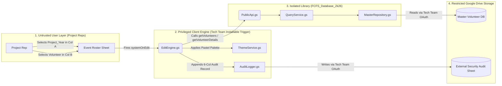

# 🛡️ NSS SCE KIIT — Secure Event Roster & Library Architecture

An enterprise-grade Google Sheets automation and security architecture built for **NSS School of Computer Engineering, KIIT University**. This system enables Project Representatives ("Reps") to dynamically assign volunteers to events via cascading dropdowns and automatic profile hydration **without granting them direct read access to the Master Volunteer Database or write access to the Security Audit Log**[cite: 2].

---

## 🏗️ Security & Privilege-Isolation Architecture

---

## 📦 Sub-Projects in this Repository

| Module | Directory | Role in Architecture |
| :--- | :--- | :--- |
| **1. FCFS Database Library** | [`./fcfs-database-library`](./fcfs-database-library) | Standalone Apps Script library (`FCFS_Database_2k26`) that encapsulates the Master Sheet ID and exposes read-only query functions (`getVolunteers`, `getVolunteerDetails`)[cite: 2]. |
| **2. Event Sheet Automation Client** | [`./event-sheet-automation-client`](./event-sheet-automation-client) | Container-bound script attached to Event Roster sheets[cite: 2]. Handles cascading dropdowns, auto-filling 6 profile columns, project color coding, duplicate removal, and tamper-proof external logging[cite: 2]. |

---

## 🔐 Key Security & Engineering Mechanisms

1. **Privilege Delegation via Installable Trigger (`TriggerInstaller.gs`)**: Standard `onEdit(e)` triggers run under the permissions of the user editing the sheet. By installing `systemOnEdit` under a Tech Team account (`setupTrigger`), the script executes with Tech Team OAuth privileges—allowing it to query the restricted Master Database and write to the restricted Audit Log while keeping both files completely locked from Reps[cite: 2].
2. **Tamper-Proof External Audit Logging (`AuditLogger.gs`)**: Every project assignment, volunteer addition, or deletion is silently streamed to an external spreadsheet (`Logs` tab) with a strict `dd-MM-yyyy HH:mm:ss` timestamp, user email, action type, row delta, source sheet title, and source URL[cite: 2].
3. **Attendance Column Protection (`ThemeService.gs` & `DataHygieneService.gs`)**: All bulk formatting and duplicate-clearing operations strictly target Columns `1` through `8` (`A–H`), leaving Column `9` (`I` - Attendance Checkboxes/Conditional Formatting) untouched[cite: 2].
4. **Zero Hardcoded Secrets**: Both `MASTER_SHEET_ID` and `EXTERNAL_LOG_SHEET_ID` are loaded dynamically at runtime via `PropertiesService.getScriptProperties()`[cite: 2].