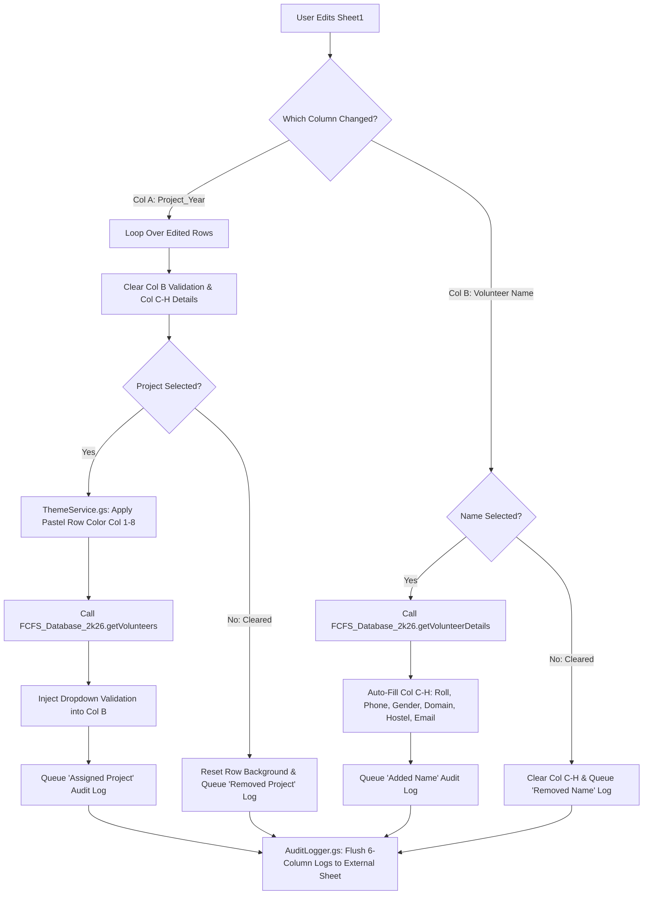

# 📊 Event Sheet Automation Client & Security Auditor

The spreadsheet-bound client engine for **NSS SCE, KIIT** event rosters[cite: 2]. It links to the `FCFS_Database_2k26` library to power real-time cascading dropdowns, automatic 6-column volunteer detail hydration, project-specific row coloring, O(N) duplicate cleanup, and silent external security auditing[cite: 2].

---

## 🏗️ Real-Time `systemOnEdit` Workflow

---

## 🎨 Project Color Palette (`ThemeService.gs`)

| Project Name | Hex Code | Visual Swatch |
| :--- | :--- | :--- |
| **Bandhutva** | `#ffcdd2` | Soft Red[cite: 2] |
| **Dhara** | `#e1bee7` | Lavender Purple[cite: 2] |
| **Nidaan** | `#c5cae9` | Indigo Tint[cite: 2] |
| **Riddhi** | `#b3e5fc` | Sky Blue[cite: 2] |
| **Sanyukt** | `#b2dfdb` | Teal Mint[cite: 2] |
| **Sparsh** | `#c8e6c9` | Pastel Green[cite: 2] |
| **Swet** | `#f0f4c3` | Lime Cream[cite: 2] |
| **Udaan** | `#ffecb3` | Warm Amber[cite: 2] |
| **Urja** | `#ffe0b2` | Soft Orange[cite: 2] |
| **Builders** | `#cfd8dc` | Distinct Silver/Grey (Leaders)[cite: 2] |

---

## 🔐 Required Script Property

In the Google Apps Script editor for the Event Sheet, open **Project Settings (⚙️) → Script Properties** and register:

| Property Key | Description |
| :--- | :--- |
| `EXTERNAL_LOG_SHEET_ID` | The Google Spreadsheet ID of the external security audit workbook containing a `Logs` tab[cite: 2]. |