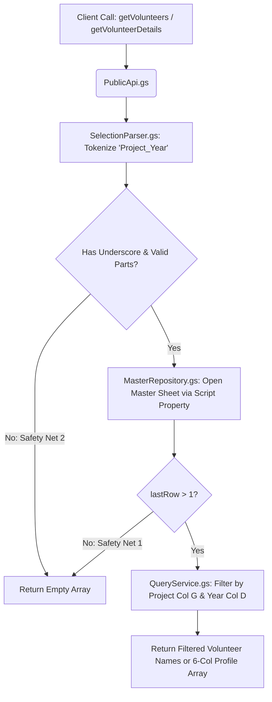

# 📚 FCFS_Database_2k26 — Master Volunteer Data Library

The backend data-access library (`FCFS_Database_2k26`) for the NSS SCE Event Roster system[cite: 2]. By deploying this script as a library and invoking it through a Tech Team installable trigger, Project Representatives can query volunteer lists and auto-populate participant details without ever having direct Google Drive access to the Master Volunteer Spreadsheet[cite: 2].

---

## 🏗️ Query Execution Pipeline

---

## 📊 Master Spreadsheet Schema (`DB_SCHEMA`)

| Column | Index (0-Based) | Field | Returned in `getVolunteerDetails()`? |
| :--- | :---: | :--- | :---: |
| **Column A** | `0` | `Volunteer Name`[cite: 2] | Used as lookup key[cite: 2] |
| **Column B** | `1` | `Roll Number`[cite: 2] | ✅ Element `0`[cite: 2] |
| **Column C** | `2` | `Phone Number`[cite: 2] | ✅ Element `1`[cite: 2] |
| **Column D** | `3` | `Academic Year`[cite: 2] | Used as filter key (`2` or `3`)[cite: 2] |
| **Column E** | `4` | `Gender`[cite: 2] | ✅ Element `2`[cite: 2] |
| **Column F** | `5` | `Domain`[cite: 2] | ✅ Element `3`[cite: 2] |
| **Column G** | `6` | `Project Name`[cite: 2] | Used as filter key[cite: 2] |
| **Column H** | `7` | `Hostel Name`[cite: 2] | ✅ Element `4`[cite: 2] |
| **Column I** | `8` | `Hostel Email`[cite: 2] | ✅ Element `5`[cite: 2] |

---

## 🔐 Required Script Property

In the Google Apps Script editor for this library, go to **Project Settings (⚙️) → Script Properties** and add:

| Property Key | Description |
| :--- | :--- |
| `MASTER_SHEET_ID` | The Google Spreadsheet ID of the Master Volunteer Database. |